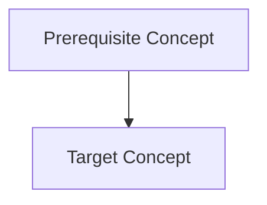

# Course Syllabus & Roadmap Template

## 1. Course Overview
- **Title**: `<Course Title>`
- **Mode**: `<quick | mastery | exam | project | research | materials | expert | troubleshooting>`
- **Level**: `<beginner | intermediate | advanced>`
- **Language**: `<en | bn>`

## 2. Prerequisite Analysis & Concept Map
- **Required Foundations**: `<List missing foundations only if strictly required>`
- **Mermaid Concept Dependency Map**:

## 3. Modules & Lessons
- **Module N**: `<Module Title>`
  - **Lesson N.M**: `<Lesson Title>` (`<concept_id>`)
    - *Objectives*: ...
    - *Core Idea & Verified Sources*: ...
    - *Hands-On Practice*: ...
    - *Knowledge Check*: ...
    - *Rule to Keep*: ...
