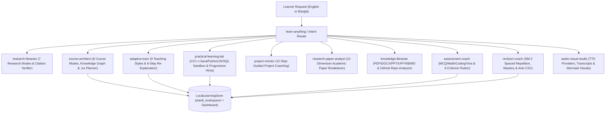

# Stardi AI — Next-Generation AI Learning Operating System

**Stardi AI** (`stardi-learning-engine` v2.0.0) is an open-source, modular AI Learning Operating System built natively for **Google Antigravity** (and compatible with CLI and other agent environments).

Instead of generating the same fixed 12-lesson audio course for every prompt, Stardi AI implements the full cognitive mastery loop:

```text
RESEARCH -> UNDERSTAND -> PLAN -> LEARN -> PRACTICE -> BUILD -> TEST -> REVIEW -> MASTER
```

It combines a **12-skill Google Antigravity Agent Skills ecosystem** (`.agents/skills/`) with a zero-bloat, stdlib-first Python engine (`learning_engine/`) and unified CLI (`scripts/stardi.py`).

---

## Architecture Overview



---

## Feature Comparison: Reference Claudemy vs. Stardi AI v2.0.0

| Capability | Reference Claudemy (`v0.3.2`) | Stardi AI Learning OS (`v2.0.0`) |
| :--- | :--- | :--- |
| **Agent Platform** | Claude Code only | **Google Antigravity** native (`.agents/AGENTS.md` + 12 skills) + Claude Code compatible |
| **Course Modes** | 1 mode (12 x 2-min audio lessons) | **8 Modes**: `quick`, `mastery`, `exam`, `project`, `research`, `materials`, `expert`, `troubleshooting` |
| **Research Modes** | Web + single author (Substack/RSS/Sitemap) | **7 Modes**: `general_web`, `academic`, `official_docs`, `expert_specific`, `user_sources`, `comparative`, `historical` + qualitative source evaluation & prompt-injection sanitization |
| **Adaptive Tutoring** | Static script generation | **9 Teaching Styles** + **6-Step Re-Explanation Protocol** for `"I don't understand X"` + misconception tracking |
| **Knowledge Graph** | None | **36-node Prerequisite & Dependency Graph** across CS, Networking, OS, DB, DSA, Python, Web, & Security + Mermaid export |
| **Practical Coding Lab** | None | **Sandboxed Code Runner** (Python, SQL, JS, C/C++) + **3-Level Progressive Hints** before solution |
| **Project Mentorship** | None | **12-Step Guided Project Mentor** with Mermaid architecture & code review checklists |
| **Assessment Engine** | None | **MCQ, Short/Long Answer, Worked Math, Coding, Scenario, Viva, & Timed Mock Exams** + 6-criterion rubric |
| **Memory & Revision** | Static `playbook.md` | **Persistent `LocalLearningStore`**, **SM-2 Spaced Repetition**, **Anki CSV Export**, & **Evidence-Based Mastery** |
| **Documents & Repos** | Web HTML only | **PDF, DOCX, PPTX, IPYNB, MD, CSV, HTML, Source Code** + **GitHub/Local Repository AST Analyzer** |
| **Academic Papers** | None | **12-Dimension Research Paper Analyst** + multi-paper comparison matrix (Claim vs. Interpretation) |
| **Multilingual Support** | English only | **English (`en`) & Bangla (`bn`)** bilingual teaching preserving English technical terminology |
| **Study Planner** | None | **Smart Study Planner** with dynamic recalculation & **RFC 5545 `.ics` Calendar Export** |
| **Audio & Visuals** | ElevenLabs + macOS `say` | **ElevenLabs + macOS `say` + Windows SAPI (`System.Speech`) + Honest Text-Only Fallback** + **Mermaid Visual Studio** |
| **Learning Dashboard** | None | **Markdown (`DASHBOARD.md`) & Standalone Offline HTML (`dashboard.html`)** |

---

## Quick Start & Installation

### 1. Prerequisites
- **Python 3.10+** (`python --version`)
- **`beautifulsoup4`** (`pip install beautifulsoup4`)
- **Optional**: `ffmpeg` (for MP3 audio rendering), `pandoc` (for `.docx` card export), `gcc`/`clang`/`node` (for C/C++/JS sandbox compilation).

### 2. Install on Windows PowerShell, Linux, or macOS

**Windows PowerShell:**
```powershell
pip install beautifulsoup4
pip install -e .
python -m unittest discover -s tests -v
```

**Linux / macOS:**
```bash
pip3 install beautifulsoup4
pip3 install -e .
python3 -m unittest discover -s tests -v
```

### 3. Using Inside Google Antigravity
Open this repository in **Google Antigravity**. Antigravity automatically discovers:
- Workspace rules in [`.agents/AGENTS.md`](./.agents/AGENTS.md)
- All 12 skills in [`.agents/skills/`](./.agents/skills/)

Simply ask in chat:
- `"Teach me Python from zero."`
- `"Teach me computer networking from beginner to advanced."`
- `"I don't understand subnetting."`
- `"Prepare me for my operating systems final exam."`
- `"Teach me DSA using C."`
- `"Teach me Django by making a library management system."`
- `"Explain this GitHub repository to me."`
- `"Teach me this research paper from beginner level."`
- `"আমাকে বাংলায় রিকার্সন (Recursion) সহজভাবে শেখাও।"`
- `"I want to learn Python in 30 days. I can study 2 hours every day."`

### 4. CLI Usage Examples (`scripts/stardi.py`)
```bash
# Route any natural-language learning request
python scripts/stardi.py route "Prepare me for my database final examination."

# Generate a course blueprint (8 modes, English or Bangla)
python scripts/stardi.py course "Computer Networking" --mode mastery --lang en
python scripts/stardi.py course "Recursion" --mode quick --lang bn

# Run 6-step adaptive re-explanation for a difficult concept
python scripts/stardi.py tutor "I don't understand subnetting."

# Practical coding lab with progressive hints (withholds solution until requested)
python scripts/stardi.py lab "Teach me DSA using C" --language c
python scripts/stardi.py lab "Teach me DSA using C" --language c --hint 1
python scripts/stardi.py lab "python-two-sum" --language python --test-reference

# Generate examination & mock test suite
python scripts/stardi.py exam "Operating Systems" --difficulty intermediate

# Generate 12-step guided project mentorship blueprint
python scripts/stardi.py project "Library Management System in Django" --tech Django

# Inspect a repository and generate a code-grounded learning roadmap
python scripts/stardi.py repo .

# Analyze a research paper across all 12 academic dimensions
python scripts/stardi.py paper "Abstract: We propose the Transformer..." --level beginner

# Create a 30-day Smart Study Plan and export an RFC 5545 .ics calendar file
python scripts/stardi.py plan "Python" --days 30 --hours 2.0 --ics "./stardi_workspace/python_30d.ics"

# Review due spaced-repetition flashcards & export Anki CSV
python scripts/stardi.py revision --anki-out "./stardi_workspace/anki.csv"

# Render Personal Learning Dashboard (Markdown + standalone offline HTML)
python scripts/stardi.py dashboard
```

---

## Documentation Index
- [Architecture Guide](./docs/ARCHITECTURE.md)
- [Complete Feature Guide (Feature Sets A–P)](./docs/FEATURES.md)
- [Setup & Installation Guide](./docs/SETUP.md)
- [Developer Guide](./docs/DEVELOPER_GUIDE.md)
- [Security Policy](./SECURITY.md)
- [Open-Source Attribution & Lineage](./ATTRIBUTION.md)
- [Changelog](./CHANGELOG.md)

---

## License & Attribution
MIT Licensed. See [`LICENSE`](./LICENSE) and [`ATTRIBUTION.md`](./ATTRIBUTION.md) for full copyright notices and attribution to Assaf Kipnis's original [Claudemy](https://github.com/assafkip/claudemy) skill.
