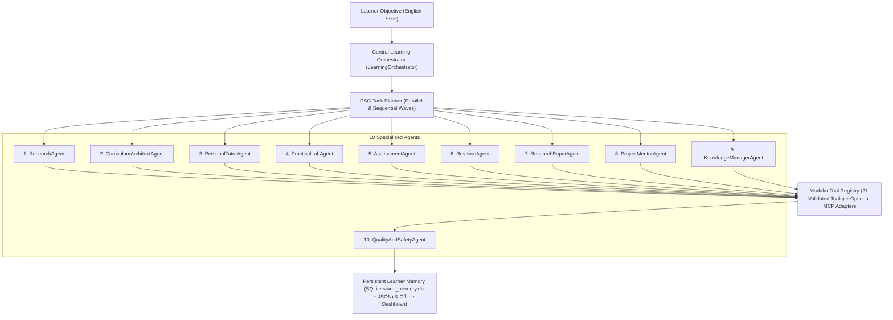

# Agentic Learning OS (`v3.0.0`)

> **Learn Anything. Build Everything. Master More.**  
> **Category**: Agentic AI / Education / Multi-Agent Systems  
> **Developer & Maintainer**: **Md. Aktaruzzaman Emon** ([@emon404x](https://github.com/emon404x))  
> **Repository**: [https://github.com/emon404x/agentic-learning-os](https://github.com/emon404x/agentic-learning-os)

[](LICENSE)
[](pyproject.toml)
[](.agents/AGENTS.md)
[](tests/)
[](https://github.com/emon404x)

**Agentic Learning OS** (`agentic-learning-os`) is a next-generation, multi-agent AI Learning Operating System designed for **Google Antigravity Agent Skills** and standalone Python/CLI workflows. It combines autonomous multi-agent orchestration, verified multi-source research, adaptive state-aware tutoring, multi-language coding laboratories, guided software project mentorship, academic paper analysis, repository AST inspection, and SM-2 spaced repetition memory.

---

## 1. Two Core Loops

### Pedagogical Mastery Loop
$$\text{RESEARCH} \rightarrow \text{UNDERSTAND} \rightarrow \text{PLAN} \rightarrow \text{LEARN} \rightarrow \text{PRACTICE} \rightarrow \text{BUILD} \rightarrow \text{TEST} \rightarrow \text{REVIEW} \rightarrow \text{MASTER}$$

### 10-Stage Agentic Execution Loop (`LearningOrchestrator`)
$$\text{UNDERSTAND} \rightarrow \text{PLAN} \rightarrow \text{SELECT\_AGENTS} \rightarrow \text{SELECT\_TOOLS} \rightarrow \text{EXECUTE} \rightarrow \text{OBSERVE} \rightarrow \text{VERIFY} \rightarrow \text{REFLECT} \rightarrow \text{SAVE\_PROGRESS} \rightarrow \text{RESPOND}$$



---

## 2. Key Capabilities

- **Central Multi-Agent Orchestrator**: Plans dependency-aware task DAGs, executes independent agents in parallel waves (`ThreadPoolExecutor`), enforces timeouts and retries, recovers gracefully from partial failures, and verifies every output via `QualityAndSafetyAgent`.
- **10 Specialized Agents & Native Antigravity Skills (`.agents/skills/`)**:
  1. `ResearchAgent` (`research-librarian`) — Multi-source discovery, qualitative evaluation, consensus vs. split comparison, strict citation verification.
  2. `CurriculumArchitectAgent` (`curriculum-architect` / `course-architect`) — 36-node prerequisite DAGs, 8 course modes (`quick`, `mastery`, `exam`, `project`, `research`, `materials`, `expert`, `troubleshooting`), and `.ics` Smart Study Planner.
  3. `PersonalTutorAgent` (`adaptive-tutor`) — 9 teaching styles, 8-step learning-state-aware adaptive re-explanation, Socratic questioning, and bilingual English/Bangla (`bn`) instruction.
  4. `PracticalLabAgent` (`practical-learning-lab`) — Coding exercises in C, C++, Java, Python, JS, SQL, HTML, CSS with 3-level progressive hints (withholding solutions) and process-isolated AST/static-checked test execution.
  5. `AssessmentAgent` (`assessment-coach`) — MCQs, short/long questions, worked math proofs, viva questions, timed mock exams, and 6-criterion formative rubric grading.
  6. `RevisionAgent` (`revision-coach`) — SuperMemo-2 (SM-2) flashcard scheduling, weak-concept tracking, and Anki CSV export.
  7. `ResearchPaperAgent` (`research-paper-analyst`) — 12-dimension academic paper analysis and multi-paper methodology comparison.
  8. `ProjectMentorAgent` (`project-mentor`) — 12-step project mentorship across Python, C/C++, Java, Django, Flutter, APIs, Databases, ML, and authorized Cybersecurity labs.
  9. `KnowledgeManagerAgent` (`knowledge-manager` / `knowledge-librarian`) — Multi-format document ingestion (PDF, DOCX, PPTX, IPYNB, MD, CSV, HTML) with preserved citations + GitHub repository AST analysis.
  10. `QualityAndSafetyAgent` (`quality-safety-guardian`) — Citation integrity checks, prompt-injection sanitization, and 5-tier Autonomy Permission enforcement (`LEVEL 0` to `LEVEL 4`).
- **Model Context Protocol (MCP) & Optional Antigravity SDK Support**: Isolated MCP connectors (`stdio` and `streamable_http`) and dynamic runtime detection for `google-antigravity` (`google.antigravity`).

---

## 3. Quick Start

```powershell
# 1. Clone and install
git clone https://github.com/emon404x/agentic-learning-os.git
cd agentic-learning-os
pip install -e .

# 2. Run the 10-Stage Multi-Agent Orchestrator
python scripts/alos.py orchestrate "Research computer networking and create a structured course with reliable sources"

# 3. Inspect specialized agents, tools, and MCP connectors
python scripts/alos.py agents
python scripts/alos.py tools
python scripts/alos.py mcp

# 4. Run all 81 automated unit, acceptance, and comprehensive audit tests
python -m unittest discover -s tests -v
```

---

## 4. Documentation Index

- [Final Comprehensive Audit Report (`docs/FINAL_AUDIT_REPORT.md`)](docs/FINAL_AUDIT_REPORT.md)
- [Agentic AI Architecture (`docs/AGENTIC_AI.md`)](docs/AGENTIC_AI.md)
- [System Architecture (`docs/ARCHITECTURE.md`)](docs/ARCHITECTURE.md)
- [Feature Reference (`docs/FEATURES.md`)](docs/FEATURES.md)
- [Installation Guide (`docs/INSTALLATION.md`)](docs/INSTALLATION.md)
- [Usage Guide (`docs/USAGE.md`)](docs/USAGE.md)
- [Developer Guide (`docs/DEVELOPER_GUIDE.md`)](docs/DEVELOPER_GUIDE.md)
- [Security & Autonomy Policy (`SECURITY.md`)](SECURITY.md)
- [Attribution & Upstream Notices (`ATTRIBUTION.md`)](ATTRIBUTION.md)
- [Third-Party Notices (`THIRD_PARTY_NOTICES.md`)](THIRD_PARTY_NOTICES.md)

---

## 5. Maintainer & License

- **Developer & Project Maintainer**: **Md. Aktaruzzaman Emon** ([@emon404x](https://github.com/emon404x))
- **License**: MIT License — see [LICENSE](LICENSE), [ATTRIBUTION.md](ATTRIBUTION.md), and [THIRD_PARTY_NOTICES.md](THIRD_PARTY_NOTICES.md) for upstream attribution to Assaf Kipnis (`assafkip/claudemy`) for the preserved audio-course skill components.
